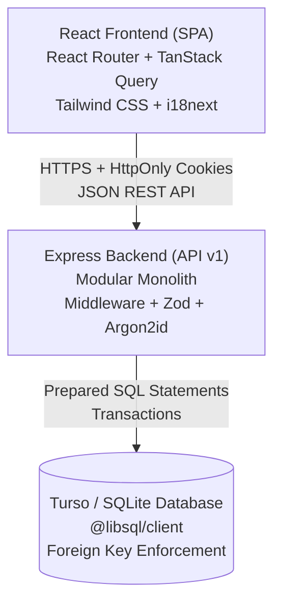
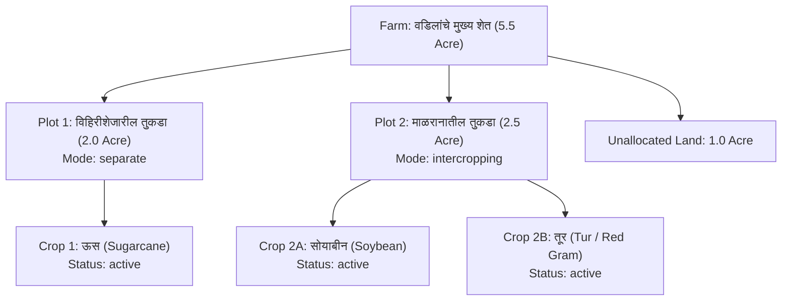
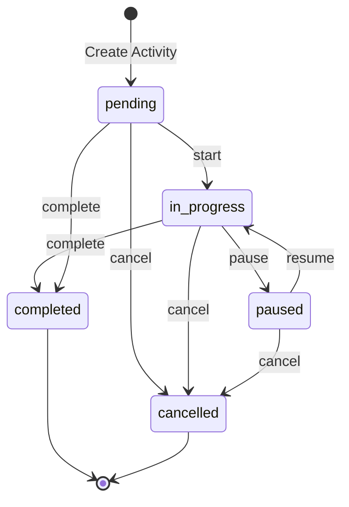

# ShetiBook — Architecture Documentation

## 1. System Overview

ShetiBook is designed as a **modular monolith** with a decoupled Single Page Application (SPA) frontend.

### Approved Five-Phase Roadmap

- **Phase 1: Foundation & Core Infrastructure** *(Completed)*: Monorepo, database migrations, phone + Argon2id authentication, 128-bit keyed recovery secrets, HTTP-only sessions, family groups with single active owner and atomic invitation consumption, audit log triggers, and Marathi/English bilingual support.
- **Phase 2: Farm & Agricultural Management** *(Completed)*: Farms, plots, land area conversions, crops, intercropping architecture, activities, and append-only event timeline.
- **Phase 3: Financial & Business Management** *(Completed)*: Expenses with Marathi agricultural categories, flexible percentage/direct crop cost allocations, reusable multi-installment payment tracking with overpayment prevention, harvest inventory with sold/remaining tracking, agricultural sales with market buyer metadata, and executive Accrual P&L & Realized Cash Flow reporting.
- **Phase 4: Intelligence & Application Experience** *(Completed)*: Executive Intelligence Dashboard (`/api/v1/groups/:groupId/dashboard`), comprehensive reporting engine with formula-sanitized UTF-8 BOM CSV export (`/api/v1/groups/:groupId/reports`), in-app notification center & 3-stage reminder escalation (`/api/v1/groups/:groupId/notifications`), offline IndexedDB operations queue with idempotent batch sync (`/api/v1/groups/:groupId/sync`), Progressive Web App shell caching (`sw.js`), and unified development orchestration (`npm run dev`).
- **Phase 5: Quality Assurance & Production Release** *(Pending)*: Integration, security, performance, deployment, backup/recovery, and handover.

---

## 2. Frontend Architecture

- **Pattern**: Feature-based architecture (`features/auth`, `features/family`, `features/agriculture`).
- **State Management**:
  - Server state: TanStack Query (cached, auto-refreshing queries, optimistic UI, mutation invalidations).
  - Auth & global session: `AuthProvider` context with automatic group selection and persistence.
- **Routing & Layouts**:
  - `AuthLayout`: Centered clean surface for public screens (Welcome, Login, Register, Recovery).
  - `AppLayout`: Standard application shell with responsive navigation header, desktop links, mobile bottom navigation bar (`md:hidden`), group badge, language switcher, and footer.
- **Internationalization**: `i18next` with `mr` (Marathi Devanagari) as primary default, fallback, and `en` (English) alternate.
- **Form Handling**: `react-hook-form` with `zodResolver` for client-side validation, live calculations, and immediate user feedback.

---

## 3. Backend Architecture

- **Pattern**: Modular Monolith organized by domain capabilities:
  - `modules/auth`: User registration, Argon2id authentication, session issuance, password recovery.
  - `modules/users`: User identity and profile endpoints.
  - `modules/family`: Group creation, membership lists, invitation management, member removal, safe deactivation.
  - `modules/agriculture`: Farms, plots, crops, intercropping validation, activities, and event history.
- **Layers**:
  1. **Router**: Express Router defining REST endpoints and applying rate limiters.
  2. **Middleware**: Centralized authentication (`requireAuth`), group membership verification (`requireGroupMembership`), and structured error handling.
  3. **Controller / Handler**: Request extraction, Zod schema validation, response formatting.
  4. **Service**: Core business logic, cryptographic operations, transactions, audit logging.
  5. **Database**: `@libsql/client` parameterized queries and schema migrations.

---

## 4. Land Area Conversion Engine (`utils/area.ts`)

ShetiBook implements a high-precision, non-accumulative area conversion model:

- **Approved Units**:
  - `acre`: 1 acre = 40 guntha = 4,046.8564224 m².
  - `guntha`: 1 guntha = 0.025 acre = 101.17141056 m².
  - `hectare`: 1 hectare = 2.4710538147 acres = 10,000 m².
- **Storage Strategy**:
  - All land areas (`farms.area_sqm`, `cultivation_plots.area_sqm`) are normalized and stored as exact square meters (`REAL NOT NULL CHECK(area_sqm > 0)`).
  - The original input value and unit (`area_value`, `area_unit`) are also persisted for auditability and display fidelity.
  - Zero cumulative rounding errors: conversions to square meters and back use floating-point arithmetic with decimal rounding only at the presentation layer.
- **Localized Breakdown (`calculateAreaBreakdown`)**:
  - Calculates whole acres and remaining gunthas (e.g., 5.5 acres = 5 acres and 20 gunthas).
  - Formats numbers in Marathi Devanagari numerals (e.g. ५ एकर, २० गुंठे) and English (5 Acre, 20 Guntha).

---

## 5. Plot Management & Intercropping Architecture

### 5.1 Physical Plot Allocation
- Each farm has an official total area (`farm.area_sqm`).
- Cultivation plots represent physical divisions of the farm.
- When creating or updating a plot, the backend asserts:
  $$\sum \text{area\_sqm}(\text{active plots}) \le \text{farm.area\_sqm}$$
  Any attempt to allocate more physical land than the farm possesses is rejected with `400 PLOT_AREA_EXCEEDS_FARM`.
- Plot names must be unique among active plots on the same farm.

### 5.2 Cultivation Modes & Intercropping
Plots support two distinct modes:
1. **Separate (`separate`)**:
   - Exactly one primary crop can be active or planned on the plot at any time.
   - Registering a second active crop is rejected with `400 PLOT_ALREADY_HAS_ACTIVE_CROP`.
2. **Intercropping (`intercropping`)**:
   - Multiple crops (e.g. Sugarcane + Soybean, or Soybean + Tur) coexist on the same physical plot.
   - Each crop record maintains its own sowing date, expected harvest date, status, and activity tracking.
   - **Physical Land Conservation**: Crucially, multiple crops sharing an intercropping plot do **not** inflate or double-count the farm's physical area. The plot's physical area is counted strictly once.
   - **Mode Switching Safeguard**: Changing a plot from `intercropping` to `separate` mode is strictly blocked if the plot currently has more than 1 active/planned crop (`400 MULTIPLE_CROPS_EXIST`).

---

## 6. Agricultural Activity Lifecycle & Append-Only Event Log

Activities track real-world farm work (Irrigation, Fertilizer application, Weeding, Spraying, Ploughing, Custom) with a strict state machine:

- **Append-Only Timeline (`activity_events`)**:
  - Every state transition inserts a permanent record in `activity_events` containing:
    - `id`: Unique identifier (UUIDv4)
    - `activity_id`: References `activities(id)`
    - `group_id`: References `farming_groups(id)`
    - `actor_id`: References `users(id)`
    - `event_type`: `'created'`, `'started'`, `'paused'`, `'resumed'`, `'completed'`, `'cancelled'`
    - `event_at`: ISO timestamp
    - `notes`: Optional description or remarks from the actor
  - History is never overwritten or mutated; the complete timeline is served chronologically to the UI.

---

## 7. Group Authorization & Isolation

Every request to an agricultural resource (`/api/v1/groups/:groupId/...`) executes `requireGroupMembership`:
1. Verifies that the requester has a valid, unexpired, non-revoked session.
2. Queries `group_members` for `group_id = :groupId AND user_id = :userId AND status = 'active'`.
3. Rejects with `403 FORBIDDEN_GROUP_ACCESS` if the user is not an active member.
4. Allows all active family members (`owner` and `member`) to collaborate on managing farms, plots, crops, and shared activities.

---

## 8. Financial & Business Management Architecture (Phase 3)

### 8.1 Monetary Integer Paise Engine
To prevent rounding errors inherent in IEEE 754 floating-point operations:
- All monetary fields (`expenses.amount_paise`, `sales.total_amount_paise`, `payments.amount_paise`, `expense_allocations.allocated_amount_paise`) are stored as exact integers in paise ($₹1 = 100\text{ paise}$).
- Inputs in Rupees ($₹$) are converted via `Math.round(rupees * 100)` at validation entry, and converted to Rupees via `paise / 100` only at presentation layer.
- Mathematical operations (sums, outstanding balances, allocations) execute strictly in integer arithmetic.

### 8.2 Dynamic Crop Cost Allocations
Agricultural expenses often span general farm maintenance (e.g. tractor diesel) or specific crops (e.g. sugarcane fertilizer):
- An expense can have 0, 1, or multiple allocations targeting specific crops (`expense_allocations`).
- **Percentage or Direct Paise**: Allocation inputs can be defined as percentage splits or explicit paise amounts.
- **Auto Farm-General Residual**: If the sum of crop allocations is less than the total expense amount:
  $$\text{Farm General Balance} = \text{Total Expense} - \sum \text{Crop Allocations}$$
  The unallocated portion is automatically accounted as general farm overhead.
- **Over-allocation Guard**: $\sum \text{Allocations} > \text{Total Expense}$ is rejected with `400 ALLOCATION_EXCEEDS_EXPENSE`.

### 8.3 Reusable Polymorphic Payments & Overpayment Protection
Farmers frequently make partial payments to agricultural input suppliers or receive payments in tranches from agricultural traders:
- A polymorphic `payments` entity links to either an expense (`payment_type = 'expense'`) or a sale (`payment_type = 'sale'`).
- **Overpayment Rejection**: Every payment request checks the existing paid sum against the total invoice amount:
  $$\text{New Payment Amount} \le \text{Total Amount} - \sum \text{Prior Payments}$$
  Any overpayment attempt is rejected with `400 PAYMENT_EXCEEDS_OUTSTANDING_BALANCE`.
- **Payment Status Derivation**:
  - `unpaid`: $\sum \text{Payments} = 0$
  - `partial`: $0 < \sum \text{Payments} < \text{Total Amount}$
  - `paid`: $\sum \text{Payments} = \text{Total Amount}$

### 8.4 Harvest Inventory & Overselling Prevention
- Harvests track physical yields (`quantity_kg`, stored in integer grams or normalized kg) and track linked sales.
- When creating a sale linked to a harvest, the service verifies available stock:
  $$\text{Sale Quantity} \le \text{Harvest Quantity} - \sum \text{Prior Linked Sales}$$
  Any overselling attempt is rejected with `400 SALE_QUANTITY_EXCEEDS_AVAILABLE_HARVEST`.

### 8.5 Dual Accounting Reporting (P&L vs Cash Flow)
The executive summary (`/finance/summary`) calculates both operational and cash-flow health:
1. **Accrual P&L**:
   $$\text{Operating Profit/Loss} = \sum \text{Sales Invoiced} - \sum \text{Expenses Incurred}$$
2. **Realized Cash Flow**:
   $$\text{Net Cash Position} = \sum \text{Cash Inflows Received} - \sum \text{Cash Outflows Paid}$$
3. **Working Capital Tracking**:
   - Accounts Receivable: $\sum \text{Sales Invoiced} - \sum \text{Inflow Payments}$
   - Accounts Payable: $\sum \text{Expenses Incurred} - \sum \text{Outflow Payments}$

