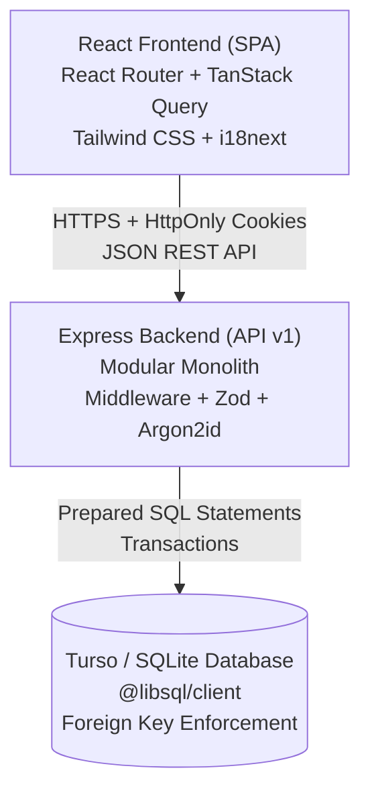

# ShetiBook — Architecture Documentation

## 1. System Overview

ShetiBook is designed as a **modular monolith** with a decoupled Single Page Application (SPA) frontend.



### Approved Five-Phase Roadmap

- **Phase 1: Foundation & Core Infrastructure** *(Current)*: Monorepo, database migrations, phone + Argon2id authentication, 128-bit keyed recovery secrets, HTTP-only sessions, family groups with single active owner and atomic invitation consumption, audit log triggers, and Marathi/English bilingual support.
- **Phase 2: Farm & Agricultural Management**: Farms, plots, crops, intercropping, and activities.
- **Phase 3: Financial & Business Management**: Expenses, allocations, payments, harvests, and sales.
- **Phase 4: Intelligence & Application Experience**: Dashboard, reports, notifications, offline synchronization, and PWA.
- **Phase 5: Quality Assurance & Production Release**: Integration, security, performance, deployment, backup/recovery, and handover.

## 2. Frontend Architecture

- **Pattern**: Feature-based architecture (`features/auth`, `features/family`).
- **State Management**:
  - Server state: TanStack Query (cached, auto-refreshing queries).
  - Auth & global session: `AuthProvider` context.
- **Routing & Layouts**:
  - `AuthLayout`: Centered clean surface for public screens (Welcome, Login, Register, Recovery).
  - `AppLayout`: Standard application shell with responsive navigation header, group badge, language switcher, and footer.
- **Internationalization**: `i18next` with `mr` (Marathi Devanagari) as primary default, fallback, and `en` (English) alternate.
- **Form Handling**: `react-hook-form` with `zodResolver` for client-side validation and immediate user feedback.

## 3. Backend Architecture

- **Pattern**: Modular Monolith organized by domain capabilities:
  - `modules/auth`: User registration, Argon2id authentication, session issuance, password recovery.
  - `modules/users`: User identity and profile endpoints.
  - `modules/family`: Group creation, membership lists, invitation management, member removal, safe deactivation.
- **Layers**:
  1. **Router**: Express Router defining REST endpoints and applying rate limiters.
  2. **Middleware**: Centralized authentication (`requireAuth`), group membership verification (`requireGroupMembership`), and structured error handling.
  3. **Controller**: Request extraction, Zod schema validation, response formatting.
  4. **Service**: Core business logic, cryptographic operations, transactions, audit logging.
  5. **Database**: `@libsql/client` parameterized queries and schema migrations.

## 4. Database Access Pattern

- **Single Client Abstraction**: Centralized via `src/database/client.ts`.
- **Relational Integrity**: `PRAGMA foreign_keys = ON;` executed on every client connection.
- **Environment Agnostic**: Works identically against local SQLite (`file:./data/shetibook.db`) and cloud Turso (`libsql://...`).
- **Transactions**: Multi-table state mutations (e.g., group creation + owner membership + audit log) executed via transactional batching (`client.batch(...)`).

## 5. Authentication Flow

```mermaid
sequenceDiagram
    participant User
    participant Client
    participant API
    participant DB

    User->>Client: Enters Phone + Password
    Client->>API: POST /api/v1/auth/login
    API->>DB: Query user by phone_number
    DB-->>API: User record (password_hash)
    API->>API: Verify password with Argon2id
    API->>API: Generate random session token & SHA-256 hash
    API->>DB: INSERT into sessions (token_hash, expires_at)
    API-->>Client: Set-Cookie: sb_session=token; HttpOnly; Lax
    Client->>API: GET /api/v1/groups (with cookie)
    API->>DB: Validate session token_hash
    DB-->>API: Active user session
    API-->>Client: User farming groups
```

## 6. Family Authorization & Isolation

Every request to a group resource (`/api/v1/groups/:groupId/*`) executes `requireGroupMembership`:
1. Verifies that the requester has a valid, unexpired, non-revoked session.
2. Queries `group_members` for `group_id = :groupId AND user_id = :userId AND status = 'active'`.
3. Rejects with `403 FORBIDDEN_GROUP_ACCESS` if the user is not an active member.
4. Validates that the user's role matches required permissions (e.g., owner-only for invitations or member removal).
