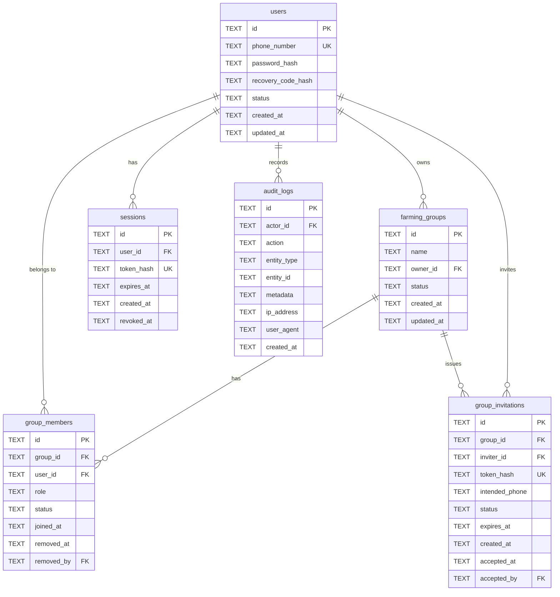

# ShetiBook — Database Documentation

## 1. Relational Database Schema (Phase 1)

ShetiBook uses a relational SQLite-compatible schema powered by `@libsql/client` (Turso). Foreign-key enforcement is enabled across all connections.

## 2. Table Specifications

### 2.1 `users`
- Stores primary user identity.
- `phone_number`: Unique, normalized 10-digit Indian mobile number.
- `password_hash`: OWASP compliant Argon2id hash.
- `recovery_code_hash`: SHA-256 hash of the 8-character recovery code. Plaintext code is never persisted.
- `status`: `'active'`, `'suspended'`, or `'deactivated'`.

### 2.2 `farming_groups`
- Represents a farming family management group.
- `owner_id`: References `users(id)` with `ON DELETE RESTRICT`.
- `status`: `'active'`, `'archived'`, `'deactivated'`.

### 2.3 `group_members`
- Junction table managing family memberships.
- `role`: Restricted to `'owner'` or `'member'`.
- `status`: `'active'` or `'removed'`.
- Unique partial index `idx_group_members_unique_active` prevents duplicate active memberships for a user in the same group.

### 2.4 `sessions`
- Database-backed user sessions.
- `token_hash`: SHA-256 hash of the cryptographically random session token.
- `expires_at`: ISO timestamp (30 days validity).
- `revoked_at`: Timestamp populated on logout or password recovery.

### 2.5 `group_invitations`
- Secure family invitations.
- `token_hash`: SHA-256 hash of the 24-byte random invitation token.
- `intended_phone`: Optional phone restriction.
- `status`: `'pending'`, `'accepted'`, `'revoked'`, `'expired'`.
- `expires_at`: ISO timestamp (7 days validity).

### 2.6 `audit_logs`
- Tamper-resistant append-only operational log for security and identity events (`USER_REGISTERED`, `USER_LOGIN`, `USER_LOGOUT`, `PASSWORD_RECOVERED`, `GROUP_CREATED`, `INVITATION_CREATED`, `INVITATION_ACCEPTED`, `MEMBER_REMOVED`, `GROUP_DEACTIVATED`).
- Never logs plaintext passwords, recovery codes, or raw tokens.

## 3. Migration System

- Migrations are version-controlled SQL files located in `server/src/database/migrations/`.
- Tracked via `schema_migrations` table.
- Deterministic lexicographical execution order (e.g. `001_initial_schema.sql`).
- Automatically verified and applied at backend startup and before automated tests.
