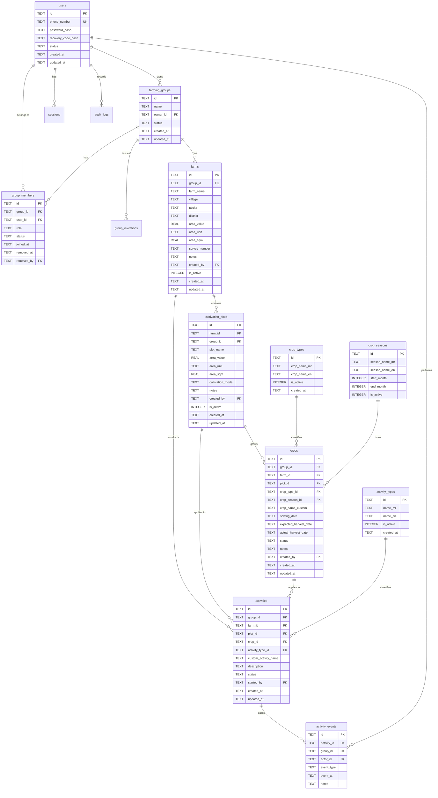

# ShetiBook — Database Documentation

## 1. Relational Database Schema (Phase 1 & Phase 2)

ShetiBook uses a relational SQLite-compatible schema powered by `@libsql/client` (Turso). Foreign-key enforcement (`PRAGMA foreign_keys = ON;`) is enabled on every client connection.



---

## 2. Table Specifications

### 2.1 Core Infrastructure Tables (Phase 1)
- `users`: Primary identity. Normalized Indian phone number, Argon2id password hash, keyed Argon2id 128-bit recovery secret hash.
- `farming_groups`: Farming family entity. Has `status` (`'active'`, `'archived'`, `'deactivated'`) and `owner_id`.
- `group_members`: Memberships with partial unique index `idx_group_members_single_active_owner` enforcing at most 1 active owner per group.
- `sessions`: Securely hashed (`token_hash`) HTTP-only bearer sessions with 30-day lifetime.
- `group_invitations`: Single-use 7-day invitations hashed via SHA-256 with atomic conditional acceptance.
- `audit_logs`: Application audit trail protected by SQLite triggers `trg_audit_logs_no_update` and `trg_audit_logs_no_delete`.

---

### 2.2 Agricultural Management Tables (Phase 2)

#### `farms`
- Represents a physical farm belonging to a family group.
- Columns:
  - `id`: Primary key (UUIDv4).
  - `group_id`: References `farming_groups(id)` ON DELETE RESTRICT.
  - `farm_name`: Display name of the farm.
  - `village`: Village location (required).
  - `taluka`: Taluka/Tehsil (optional).
  - `district`: District (optional).
  - `area_value`: Original input numeric area (`CHECK(area_value > 0)`).
  - `area_unit`: Original input unit (`CHECK(area_unit IN ('acre', 'guntha', 'hectare'))`).
  - `area_sqm`: Normalized area in square meters (`CHECK(area_sqm > 0)`).
  - `survey_number`: Official 7/12 land survey number (गट क्रमांक / सर्व्हे नंबर).
  - `notes`: Remarks, soil type, water source.
  - `created_by`: References `users(id)`.
  - `is_active`: Soft-deletion flag (`INTEGER NOT NULL DEFAULT 1 CHECK(is_active IN (0, 1))`).
  - `created_at`, `updated_at`: ISO timestamps.

#### `cultivation_plots`
- Represents a physical division / plot inside a farm.
- Columns:
  - `id`: Primary key (UUIDv4).
  - `farm_id`: References `farms(id)` ON DELETE RESTRICT.
  - `group_id`: References `farming_groups(id)` ON DELETE RESTRICT.
  - `plot_name`: Distinct plot identifier.
  - `area_value`, `area_unit`, `area_sqm`: Physical land area of the plot.
  - `cultivation_mode`: `'separate'` (single crop) or `'intercropping'` (multiple coexisting crops).
  - `notes`: Plot soil notes or irrigation method.
  - `created_by`: References `users(id)`.
  - `is_active`: Soft-deletion flag.

#### `crop_types` & `crop_seasons`
- Standard master tables pre-seeded with Maharashtra crops and agricultural seasons:
  - 11 pre-seeded crops: Cotton (कापूस), Soybean (सोयाबीन), Sugarcane (ऊस), Onion (कांदा), Tur/Arhar (तूर), Gram/Chana (हरभरा), Wheat (गहू), Bajra (बाजरी), Jowar (ज्वारी), Maize (मका), Pomegranate (डाळिंब).
  - 4 pre-seeded seasons: Kharif (खरीप, Jun–Oct), Rabi (रब्बी, Oct–Mar), Zaid/Summer (उन्हाळी, Mar–Jun), Annual (बारमाही).

#### `crops`
- Represents a specific crop sown on a plot.
- Columns:
  - `id`: Primary key (UUIDv4).
  - `group_id`, `farm_id`, `plot_id`: Relational hierarchy references.
  - `crop_type_id`: References `crop_types(id)`.
  - `crop_season_id`: References `crop_seasons(id)`.
  - `crop_name_custom`: Optional variety name (e.g. "को ८६०३२", "जेएस ३३५").
  - `sowing_date`: ISO date string (YYYY-MM-DD).
  - `expected_harvest_date`, `actual_harvest_date`: Optional harvest date strings.
  - `status`: `'planned'`, `'active'`, `'harvested'`, `'cancelled'`.
  - `notes`: Variety, seed source, notes.
  - `created_by`: References `users(id)`.

#### `activity_types`
- Master activity categories pre-seeded with 6 operations:
  - Irrigation (पाणी व्यवस्थापन)
  - Fertilizer Application (खत व्यवस्थापन)
  - Weeding & Intercultural (खुरपणी व कोळपणी)
  - Spraying & Pest Control (कीटकनाशक फवारणी)
  - Ploughing & Land Prep (नांगरणी व मशागत)
  - Other Operations (इतर कामे)

#### `activities` & `activity_events`
- `activities`: Tracks task execution on a farm, plot, or specific crop with status `'pending'`, `'in_progress'`, `'paused'`, `'completed'`.
- `activity_events`: Append-only audit timeline recording every state transition (`created`, `started`, `paused`, `resumed`, `completed`, `cancelled`) with `actor_id` and timestamp `event_at`.

---

## 3. Database Indexes

To ensure fast queries and high concurrency under multi-tenant family access:

```sql
CREATE INDEX idx_farms_group_id ON farms(group_id);
CREATE INDEX idx_cultivation_plots_farm_id ON cultivation_plots(farm_id);
CREATE INDEX idx_cultivation_plots_group_id ON cultivation_plots(group_id);
CREATE INDEX idx_crops_farm_id ON crops(farm_id);
CREATE INDEX idx_crops_plot_id ON crops(plot_id);
CREATE INDEX idx_crops_group_id ON crops(group_id);
CREATE INDEX idx_activities_farm_id ON activities(farm_id);
CREATE INDEX idx_activities_plot_id ON activities(plot_id);
CREATE INDEX idx_activities_crop_id ON activities(crop_id);
CREATE INDEX idx_activities_group_id ON activities(group_id);
CREATE INDEX idx_activity_events_activity_id ON activity_events(activity_id);
CREATE INDEX idx_activity_events_group_id ON activity_events(group_id);
```
