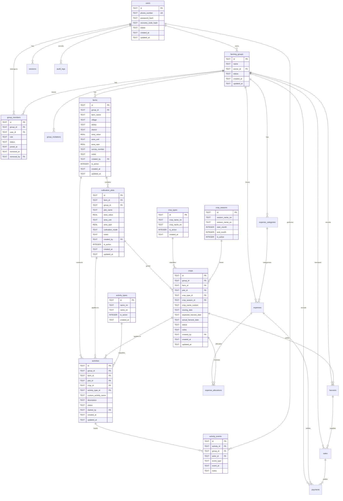

# ShetiBook — Database Documentation

## 1. Relational Database Schema (Phase 1, Phase 2 & Phase 3)

ShetiBook uses a relational SQLite-compatible schema powered by `@libsql/client` (Turso). Foreign-key enforcement (`PRAGMA foreign_keys = ON;`) is enabled on every client connection.



---

## 2. Table Specifications

### 2.1 Core Infrastructure Tables (Phase 1)
- `users`: Primary identity. Normalized Indian phone number, Argon2id password hash, keyed Argon2id 128-bit recovery secret hash.
- `farming_groups`: Farming family entity. Has `status` (`'active'`, `'archived'`, `'deactivated'`) and `owner_id`.
- `group_members`: Memberships with partial unique index `idx_group_members_single_active_owner` enforcing at most 1 active owner per group.
- `sessions`: Securely hashed (`token_hash`) HTTP-only bearer sessions with 30-day lifetime.
- `group_invitations`: Single-use 7-day invitations hashed via SHA-256 with atomic conditional acceptance.
- `audit_logs`: Application audit trail protected by SQLite triggers `trg_audit_logs_no_update` and `trg_audit_logs_no_delete`.

---

### 2.2 Agricultural Management Tables (Phase 2)

#### `farms`
- Represents a physical farm belonging to a family group.
- Columns:
  - `id`: Primary key (UUIDv4).
  - `group_id`: References `farming_groups(id)` ON DELETE RESTRICT.
  - `farm_name`: Display name of the farm.
  - `village`: Village location (required).
  - `taluka`: Taluka/Tehsil (optional).
  - `district`: District (optional).
  - `area_value`: Original input numeric area (`CHECK(area_value > 0)`).
  - `area_unit`: Original input unit (`CHECK(area_unit IN ('acre', 'guntha', 'hectare'))`).
  - `area_sqm`: Normalized area in square meters (`CHECK(area_sqm > 0)`).
  - `survey_number`: Official 7/12 land survey number (गट क्रमांक / सर्व्हे नंबर).
  - `notes`: Remarks, soil type, water source.
  - `created_by`: References `users(id)`.
  - `is_active`: Soft-deletion flag (`INTEGER NOT NULL DEFAULT 1 CHECK(is_active IN (0, 1))`).
  - `created_at`, `updated_at`: ISO timestamps.

#### `cultivation_plots`
- Represents a physical division / plot inside a farm.
- Columns:
  - `id`: Primary key (UUIDv4).
  - `farm_id`: References `farms(id)` ON DELETE RESTRICT.
  - `group_id`: References `farming_groups(id)` ON DELETE RESTRICT.
  - `plot_name`: Distinct plot identifier.
  - `area_value`, `area_unit`, `area_sqm`: Physical land area of the plot.
  - `cultivation_mode`: `'separate'` (single crop) or `'intercropping'` (multiple coexisting crops).
  - `notes`: Plot soil notes or irrigation method.
  - `created_by`: References `users(id)`.
  - `is_active`: Soft-deletion flag.

#### `crop_types` & `crop_seasons`
- Standard master tables pre-seeded with Maharashtra crops and agricultural seasons:
  - 11 pre-seeded crops: Cotton (कापूस), Soybean (सोयाबीन), Sugarcane (ऊस), Onion (कांदा), Tur/Arhar (तूर), Gram/Chana (हरभरा), Wheat (गहू), Bajra (बाजरी), Jowar (ज्वारी), Maize (मका), Pomegranate (डाळिंब).
  - 4 pre-seeded seasons: Kharif (खरीप, Jun–Oct), Rabi (रब्बी, Oct–Mar), Zaid/Summer (उन्हाळी, Mar–Jun), Annual (बारमाही).

#### `crops`
- Represents a specific crop sown on a plot.
- Columns:
  - `id`: Primary key (UUIDv4).
  - `group_id`, `farm_id`, `plot_id`: Relational hierarchy references.
  - `crop_type_id`: References `crop_types(id)`.
  - `crop_season_id`: References `crop_seasons(id)`.
  - `crop_name_custom`: Optional variety name (e.g. "को ८६०३२", "जेएस ३३५").
  - `sowing_date`: ISO date string (YYYY-MM-DD).
  - `expected_harvest_date`, `actual_harvest_date`: Optional harvest date strings.
  - `status`: `'planned'`, `'active'`, `'harvested'`, `'cancelled'`.
  - `notes`: Variety, seed source, notes.
  - `created_by`: References `users(id)`.

#### `activity_types`
- Master activity categories pre-seeded with 6 operations:
  - Irrigation (पाणी व्यवस्थापन)
  - Fertilizer Application (खत व्यवस्थापन)
  - Weeding & Intercultural (खुरपणी व कोळपणी)
  - Spraying & Pest Control (कीटकनाशक फवारणी)
  - Ploughing & Land Prep (नांगरणी व मशागत)
  - Other Operations (इतर कामे)

#### `activities` & `activity_events`
- `activities`: Tracks task execution on a farm, plot, or specific crop with status `'pending'`, `'in_progress'`, `'paused'`, `'completed'`.
- `activity_events`: Append-only audit timeline recording every state transition (`created`, `started`, `paused`, `resumed`, `completed`, `cancelled`) with `actor_id` and timestamp `event_at`.

---

## 3. Database Indexes

To ensure fast queries and high concurrency under multi-tenant family access:

```sql
CREATE INDEX idx_farms_group_id ON farms(group_id);
CREATE INDEX idx_cultivation_plots_farm_id ON cultivation_plots(farm_id);
CREATE INDEX idx_cultivation_plots_group_id ON cultivation_plots(group_id);
CREATE INDEX idx_crops_farm_id ON crops(farm_id);
CREATE INDEX idx_crops_plot_id ON crops(plot_id);
CREATE INDEX idx_crops_group_id ON crops(group_id);
CREATE INDEX idx_activities_farm_id ON activities(farm_id);
CREATE INDEX idx_activities_plot_id ON activities(plot_id);
CREATE INDEX idx_activities_crop_id ON activities(crop_id);
CREATE INDEX idx_activities_group_id ON activities(group_id);
CREATE INDEX idx_activity_events_activity_id ON activity_events(activity_id);
CREATE INDEX idx_activity_events_group_id ON activity_events(group_id);

-- Phase 3: Financial Management Indexes
CREATE INDEX idx_expenses_group_id ON expenses(group_id);
CREATE INDEX idx_expenses_category_id ON expenses(category_id);
CREATE INDEX idx_expenses_farm_id ON expenses(farm_id);
CREATE INDEX idx_expenses_expense_date ON expenses(expense_date);
CREATE INDEX idx_expense_allocations_expense_id ON expense_allocations(expense_id);
CREATE INDEX idx_expense_allocations_crop_id ON expense_allocations(crop_id);
CREATE INDEX idx_harvests_group_id ON harvests(group_id);
CREATE INDEX idx_harvests_crop_id ON harvests(crop_id);
CREATE INDEX idx_harvests_harvest_date ON harvests(harvest_date);
CREATE INDEX idx_sales_group_id ON sales(group_id);
CREATE INDEX idx_sales_crop_id ON sales(crop_id);
CREATE INDEX idx_sales_harvest_id ON sales(harvest_id);
CREATE INDEX idx_sales_sale_date ON sales(sale_date);
CREATE INDEX idx_payments_group_id ON payments(group_id);
CREATE INDEX idx_payments_expense_id ON payments(expense_id);
CREATE INDEX idx_payments_sale_id ON payments(sale_id);
CREATE INDEX idx_payments_payment_date ON payments(payment_date);
```

---

## 4. Financial & Business Schema Entities (Phase 3)

### 4.1 `expense_categories`
Master table of expenditure categories with regional Marathi names:
- Pre-seeded categories:
  1. Seeds & Seedlings (बियाणे व रोपे)
  2. Fertilizers & Manure (खते व सेंद्रिय खते)
  3. Pesticides & Insecticides (कीटकनाशके व तणनाशके)
  4. Labor & Daily Wages (मजुरी व कामाचा खर्च)
  5. Machinery & Fuel (ट्रॅक्टर, यंत्रसामग्री व डिझेल)
  6. Irrigation & Water (पाणी व ठिबक खर्च)
  7. Electricity & Utility (वीजबिल व वीज जोडणी)
  8. Packaging & Transportation (वाहतूक व पॅकिंग खर्च)
  9. Land Lease & Rent (जमीन भाडेपट्टी / खंड)
  10. Miscellaneous (इतर किरकोळ खर्च)

### 4.2 `expenses`
Header record for every agricultural expenditure:
- `id`: Primary key (UUIDv4).
- `group_id`: References `farming_groups(id)`.
- `farm_id`: References `farms(id)` (optional general farm association).
- `category_id`: References `expense_categories(id)`.
- `amount_paise`: Integer paise ($> 0$).
- `expense_date`: ISO date (YYYY-MM-DD).
- `payment_status`: `'unpaid'`, `'partial'`, `'paid'`.
- `vendor_name`: Input supplier or laborer name.
- `payment_method`: `'cash'`, `'upi'`, `'bank_transfer'`, `'credit'`.
- `receipt_url`: Optional scanned receipt URL.
- `notes`: Specific item details or purchase notes.
- `created_by`: References `users(id)`.

### 4.3 `expense_allocations`
Allocation records distributing an expense across specific crops:
- `id`: Primary key (UUIDv4).
- `expense_id`: References `expenses(id)` ON DELETE CASCADE.
- `crop_id`: References `crops(id)`.
- `allocated_amount_paise`: Integer paise allocated to this crop.
- `percentage`: Percentage of the total expense.

### 4.4 `harvests`
Agricultural harvest records tracking yields and inventory:
- `id`: Primary key (UUIDv4).
- `group_id`: References `farming_groups(id)`.
- `crop_id`: References `crops(id)`.
- `harvest_date`: ISO date.
- `quantity`: Original quantity value entered by farmer.
- `unit`: Unit (`'kg'`, `'quintal'`, `'ton'`, `'crate'`).
- `quantity_kg`: Normalized weight in kilograms.
- `quality_grade`: Quality rating (`'Grade A'`, `'Grade B'`, `'Commercial'`).
- `storage_location`: Field, warehouse, cold storage location.
- `notes`: Harvest notes and picker details.
- `created_by`: References `users(id)`.

### 4.5 `sales`
Commercial sales of farm produce:
- `id`: Primary key (UUIDv4).
- `group_id`: References `farming_groups(id)`.
- `crop_id`: References `crops(id)`.
- `harvest_id`: Optional reference to `harvests(id)` when sold from stock.
- `sale_date`: ISO date.
- `buyer_name`: Market trader or direct purchaser name.
- `market_name`: APMC mandi name (e.g. "पुणे गुलटेकडी मार्केट", "सोलापूर कृषी उत्पन्न बाजार समिती").
- `quantity`: Quantity sold.
- `unit`: Measurement unit (`'kg'`, `'quintal'`, `'ton'`, `'crate'`).
- `quantity_kg`: Normalized kilograms.
- `rate_per_unit_paise`: Price per unit in paise.
- `total_amount_paise`: Total sale value in integer paise.
- `payment_status`: `'unpaid'`, `'partial'`, `'paid'`.
- `notes`: Gate pass number, vehicle details, moisture deduction remarks.
- `created_by`: References `users(id)`.

### 4.6 `payments`
Reusable multi-installment payment transaction ledger:
- `id`: Primary key (UUIDv4).
- `group_id`: References `farming_groups(id)`.
- `payment_type`: Polymorphic discriminant (`'expense'` for outgoing payables, `'sale'` for incoming receivables).
- `expense_id`: References `expenses(id)` when `payment_type = 'expense'`.
- `sale_id`: References `sales(id)` when `payment_type = 'sale'`.
- `amount_paise`: Payment installment in integer paise ($> 0$).
- `payment_date`: ISO date.
- `payment_mode`: `'cash'`, `'upi'`, `'bank_transfer'`, `'cheque'`.
- `reference_number`: Bank reference, UTR, or cheque number.
- `notes`: Installment remarks.
- `created_by`: References `users(id)`.

---

## 5. Intelligence, Notifications & Offline Sync Schema (Phase 4)

### 5.1 `notifications`
In-app notification center for activity alerts, escalations, and financial updates:
- `id`: Primary key (UUIDv4).
- `group_id`: References `farming_groups(id)`.
- `user_id`: Target recipient references `users(id)`.
- `title`: Notification headline in Marathi/English.
- `message`: Detailed description of the event.
- `type`: Enum `'activity_reminder'`, `'activity_escalation'`, `'financial_alert'`, `'sync_status'`, `'general'`.
- `entity_type`: Optional entity classifier (`'activity'`, `'expense'`, `'sale'`).
- `entity_id`: Optional target entity ID for in-app deep linking.
- `is_read`: Boolean flag (0 or 1).
- `read_at`: Timestamp when acknowledged.
- `created_at`: ISO timestamp.

### 5.2 `activity_reminders`
Automated multi-stage scheduled reminders for ongoing farm tasks:
- `id`: Primary key (UUIDv4).
- `group_id`: References `farming_groups(id)`.
- `activity_id`: References `activities(id)` ON DELETE CASCADE.
- `remind_at`: ISO timestamp when reminder is triggered.
- `stage`: Enum `'first'` (2 hours before), `'second'` (30 minutes before), `'escalation'` (1 minute after / family alert).
- `target_user_id`: Target user or NULL for group-wide broadcast.
- `status`: Enum `'pending'`, `'sent'`, `'cancelled'`, `'paused'`.
- `sent_at`: Timestamp when delivered.
- `created_at`: ISO timestamp.

### 5.3 `notification_preferences`
Per-user notification delivery toggles:
- `id`: Primary key (UUIDv4).
- `group_id`: References `farming_groups(id)`.
- `user_id`: References `users(id)`.
- `activity_reminders`: Boolean flag (default 1).
- `family_escalations`: Boolean flag (default 1).
- `financial_alerts`: Boolean flag (default 1).
- `web_push_enabled`: Boolean flag (default 0).
- `created_at`: ISO timestamp.
- `updated_at`: ISO timestamp.

### 5.4 `push_subscriptions`
Web Push API subscription endpoints for browser push notifications:
- `id`: Primary key (UUIDv4).
- `user_id`: References `users(id)` ON DELETE CASCADE.
- `endpoint`: Unique Web Push URL.
- `p256dh_key`: Public elliptic curve key.
- `auth_key`: Authentication secret.
- `user_agent`: Browser/device user agent string.
- `is_active`: Boolean flag (0 or 1).
- `created_at`: ISO timestamp.

### 5.5 `sync_operations`
Audit log and idempotency ledger for offline mutations:
- `id`: Primary key (UUIDv4).
- `group_id`: References `farming_groups(id)`.
- `user_id`: References `users(id)`.
- `device_id`: Client device identifier.
- `client_operation_id`: Unique idempotency key generated by client IndexedDB.
- `entity_type`: Enum `'expense'`, `'payment'`, `'harvest'`, `'sale'`, `'activity'`, `'activity_transition'`.
- `operation`: Enum `'create'`, `'update'`, `'delete'`, `'transition'`.
- `entity_id`: Server-assigned entity UUID.
- `payload_json`: Full mutation payload for debugging and conflict replay.
- `status`: Enum `'success'`, `'failed'`, `'conflict'`.
- `error_message`: Error details if rejected.
- `synced_at`: ISO timestamp.

### 5.6 `device_registrations`
Tracks devices syncing offline records:
- `id`: Primary key (UUIDv4).
- `user_id`: References `users(id)`.
- `group_id`: References `farming_groups(id)`.
- `device_id`: Device identifier.
- `device_name`: Human-readable device name (e.g. "Samsung Galaxy M31").
- `last_sync_at`: ISO timestamp of most recent batch sync.
- `created_at`: ISO timestamp.

### 5.7 Phase 4 Performance Indexes
```sql
CREATE INDEX idx_notifications_user ON notifications(user_id, is_read, created_at);
CREATE INDEX idx_notifications_group ON notifications(group_id, created_at);
CREATE INDEX idx_reminders_activity ON activity_reminders(activity_id, status);
CREATE INDEX idx_reminders_due ON activity_reminders(remind_at, status);
CREATE INDEX idx_sync_client_op ON sync_operations(client_operation_id);
CREATE INDEX idx_sync_group_device ON sync_operations(group_id, device_id);
CREATE INDEX idx_device_user ON device_registrations(user_id, group_id);
CREATE INDEX idx_push_user ON push_subscriptions(user_id, is_active);
```

